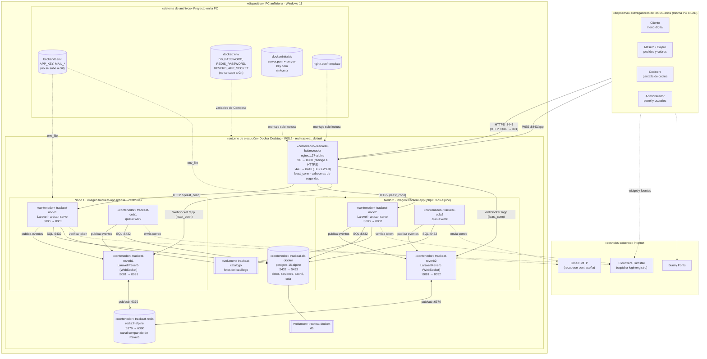
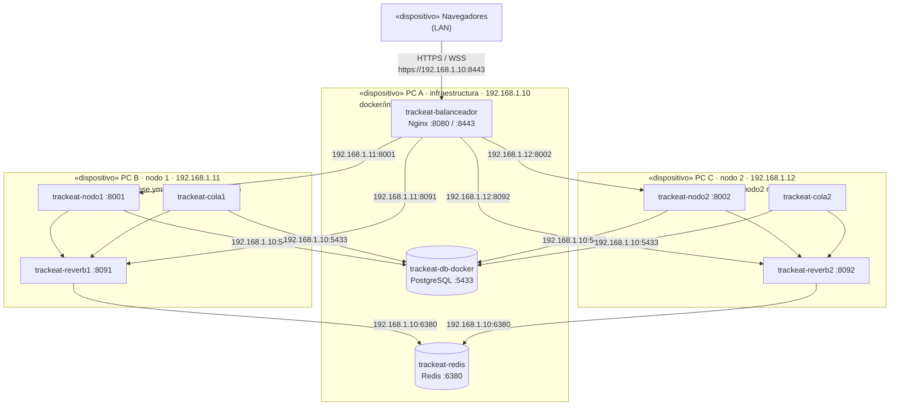
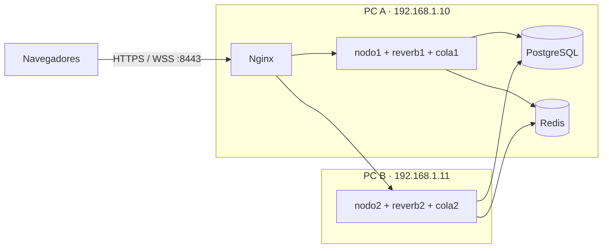
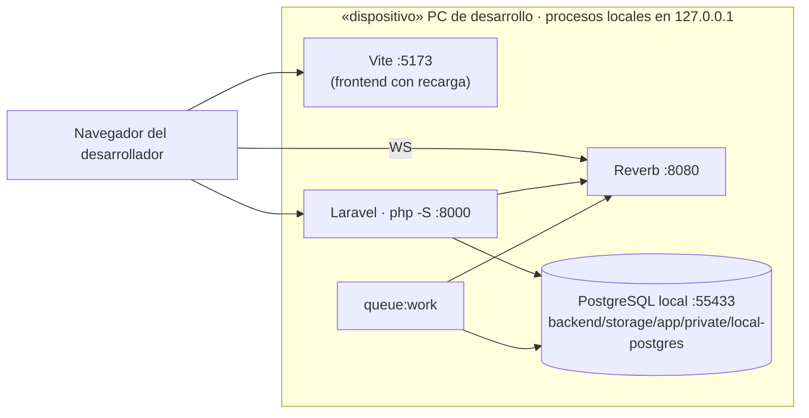
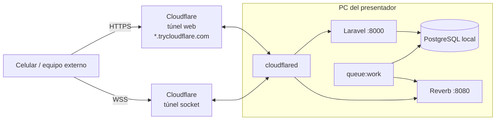

# Diagrama de despliegue · TrackEat

Aplicaciones Web II · Documentación técnica
Instituto Tecnológico de La Paz · Grupo 8-H

Este documento muestra **dónde corre cada pieza de TrackEat** y cómo se conectan. Se describen cuatro arquitecturas. La **principal**, que se usa en la entrega y en la presentación, es el **despliegue en una sola PC con Docker Compose**. Las demás se incluyen como alternativas y se indica cuáles se han probado.

| # | Arquitectura | Archivos / comando | Estado |
|---|---|---|---|
| **1** | **Una sola PC con Docker (principal)** | `docker/compose.yml` | **Probada**; es la de la presentación |
| 2 | Tres PCs en la misma red (infraestructura + 2 nodos) | `docker/infra/compose.yml` y `docker/nodo/compose.yml` | Configurada, sin probar entre equipos |
| 2b | Variante de dos PCs | Los mismos archivos que la 2 | Configurada, sin probar |
| 3 | Desarrollo local sin Docker | `iniciar-base-datos.bat` y `iniciar.bat` | Probada; solo para desarrollo |
| 4 | Presentación remota con túnel de Cloudflare | `presentar.bat` | Probada; demo temporal, no para producción |

---

## 1. Arquitectura principal: una sola PC con Docker Compose

Todo corre en una computadora con **Windows 11 + Docker Desktop (WSL2)**. `docker/compose.yml` incluye los dos archivos de la práctica (`infra/compose.yml` y `nodo/compose.yml`) y levanta **9 contenedores** en una sola red de Docker (`trackeat_default`, `172.18.0.0/16`). Los contenedores se encuentran **por nombre** (`db`, `redis`, `nodo1`, `reverb2`...), no por IP.

```powershell
docker compose --env-file docker/.env -f docker/compose.yml up -d --build
docker compose --env-file docker/.env -f docker/compose.yml exec nodo1 php artisan migrate --seed --force   # primera vez
```

### 1.1 Diagrama



> Si el visor no muestra Mermaid, la versión en texto del mismo montaje (con las IPs reales de la red de Docker) está en [informe-practica-5.md](../informe-practica-5.md#2-diagrama).

### 1.2 Nodos y artefactos

| Elemento | Tipo | Imagen / origen | Puerto interno → anfitrión | Función |
|---|---|---|---|---|
| PC anfitriona | Dispositivo | Windows 11 | — | Ejecuta Docker Desktop y guarda los `.env`, el certificado y el código |
| Docker Desktop | Entorno de ejecución | WSL2, Compose v5 | — | Crea la red `trackeat_default` y los volúmenes |
| `trackeat-balanceador` | Contenedor | `nginx:1.27-alpine` | 80 → **8080**, 443 → **8443** | Única puerta de entrada. Termina TLS, redirige HTTP a HTTPS, reparte con `least_conn` y añade CSP, HSTS, `X-Content-Type-Options`, `Referrer-Policy`, `Permissions-Policy` y `X-Nodo` |
| `trackeat-nodo1` / `nodo2` | Contenedor | `trackeat-app` (construida con `docker/Dockerfile`) | 8000 → 8001 / 8002 | Aplicación Laravel con el frontend React ya compilado en `public/build` |
| `trackeat-reverb1` / `reverb2` | Contenedor | `trackeat-app` | 8081 → 8091 / 8092 | WebSockets en tiempo real (comandas, estado de pedidos). Uno por nodo |
| `trackeat-cola1` / `cola2` | Contenedor | `trackeat-app` | — | Procesan los trabajos en segundo plano (eventos, correos) |
| `trackeat-db-docker` | Contenedor | `postgres:16-alpine` | 5432 → 5433 | Base única: datos, sesiones (`SESSION_DRIVER=database`), caché y cola |
| `trackeat-redis` | Contenedor | `redis:7-alpine` | 6379 → 6380 | Canal pub/sub para que un evento llegue a los dos Reverb (`REVERB_SCALING_ENABLED=true`) |
| `trackeat-docker-db` | Volumen | Docker | — | Conserva los datos de PostgreSQL al recrear el contenedor |
| `trackeat-catalogo` | Volumen | Docker | — | Fotos del catálogo, compartidas por los dos nodos |
| `backend/.env` | Archivo de configuración | Local, ignorado por Git | — | `APP_KEY` (la misma en los dos nodos) y correo |
| `docker/.env` | Archivo de configuración | Local, ignorado por Git | — | Contraseñas de PostgreSQL y Redis y el secreto de Reverb |
| `docker/infra/tls/` | Certificado | mkcert | — | Certificado y llave del HTTPS, montados en solo lectura |

Todos los puertos se publican en `127.0.0.1` (variable `ESCUCHA`), así que **desde fuera de la PC solo se llega al balanceador** cuando se configura para la red local. Los puertos 8001/8002 y 8091/8092 sirven para pruebas directas a un nodo.

### 1.3 Flujo de una petición

1. El navegador abre `https://localhost:8443`. Si entra por `http://…:8080`, Nginx responde **301** a HTTPS.
2. Nginx termina TLS y envía la petición al nodo con menos conexiones activas (`least_conn`). Si un nodo falla, `proxy_next_upstream` reintenta en el otro.
3. El nodo atiende con Laravel y lee y escribe en PostgreSQL. La sesión vive en la base, así que cualquier nodo la reconoce.
4. Cuando cambia un pedido, el nodo o su cola publica el evento en **su** Reverb, este lo difunde por Redis y **los dos** Reverb lo entregan a las pantallas conectadas (`wss://…:8443/app`).

### 1.4 Puntos únicos de falla

| Si cae… | Efecto |
|---|---|
| Un nodo, un Reverb o una cola | El sistema sigue: Nginx usa el otro |
| Redis | La app funciona, pero los eventos en vivo no cruzan entre Reverb (el frontend consulta cada 5 s como respaldo) |
| PostgreSQL | Cae la aplicación (`/salud` responde 503) |
| Nginx | Nadie puede entrar |
| **La PC** | Cae todo: es la limitación de esta arquitectura |

---

## 2. Alternativa: tres PCs en la misma red

Se usan los mismos archivos y la misma imagen. La infraestructura se separa de los nodos y los contenedores se encuentran por **IP de la PC y puerto publicado**, configurados en `docker/.env` (el mismo archivo en las tres PCs, con `ESCUCHA=0.0.0.0`). La guía completa está en [cambiar a 3 pc.md](../../cambiar%20a%203%20pc.md).



| PC | Contenedores | Puertos a abrir en el firewall |
|---|---|---|
| A · infraestructura | PostgreSQL, Redis, Nginx | 8080, 8443, 5433, 6380 |
| B · nodo 1 | `nodo1`, `reverb1`, `cola1` | 8001, 8091 |
| C · nodo 2 | `nodo2`, `reverb2`, `cola2` | 8002, 8092 |

**Requisitos propios de este modo:** el mismo `backend/.env` (misma `APP_KEY`) en B y C para que la sesión sirva en ambos nodos; el frontend compilado en B y C; las fotos del catálogo se siembran en cada PC de nodo, porque el volumen `trackeat-catalogo` no se comparte entre equipos.

**Ventaja sobre la principal:** apagar una PC de nodo no tira el sistema y cada nodo tiene su propio procesador. **Desventaja:** la PC A sigue siendo punto único de falla (base, Redis y balanceador) y depende de la red y de IPs fijas.

### 2b. Variante de dos PCs

La PC A corre la infraestructura **y** el nodo 1. La segunda PC corre el nodo 2. En `docker/.env` se pone `NODO1_ADDR=192.168.1.10:8001` y `REVERB1_ADDR=192.168.1.10:8091`, y en la PC A se abren también los puertos 8001 y 8091.



---

## 3. Desarrollo local sin Docker

Para programar se usa la PC del desarrollador sin contenedores. `iniciar-base-datos.bat` crea un PostgreSQL local y `iniciar.bat` arranca los procesos con `scripts/trackeat.ps1`. Hay **un solo nodo** y no hay balanceador, HTTPS ni Redis (no hacen falta con un único Reverb).



Requiere PostgreSQL 15+, PHP 8.2+, Composer y Node.js con pnpm instalados en la PC. Si un puerto está ocupado, el script elige el siguiente libre.

---

## 4. Presentación remota con túnel de Cloudflare

`presentar.bat` (`scripts/presentacion.ps1 -Tunnel`) levanta el mismo montaje de un nodo (`php -S :8000`, Reverb `:8080` y cola) con el frontend compilado y `APP_DEBUG=false`, y abre **dos túneles de `cloudflared`**, uno para la web y otro para el WebSocket. Así se puede abrir el sistema desde un celular o desde fuera de la red del salón sin abrir puertos.



Las direcciones del túnel cambian en cada arranque y dependen de un servicio de terceros, así que esta arquitectura **solo sirve para demostraciones**.

---

## 5. Comparación

| Criterio | 1 · Una PC (principal) | 2 · Tres PCs | 3 · Desarrollo local | 4 · Túnel |
|---|---|---|---|---|
| Contenedores | 9 | 3 + 3 + 3 | Ninguno | Ninguno |
| Nodos de aplicación | 2 | 2 | 1 | 1 |
| Balanceador y HTTPS | Sí (Nginx + mkcert) | Sí | No | HTTPS lo pone Cloudflare |
| Tolerancia a caída de un nodo | Sí | Sí, incluso a una PC de nodo | No | No |
| Tolerancia a caída de la PC | No | Parcial (si no es la PC A) | No | No |
| Preparación | Docker Desktop, `.env`, certificado, `pnpm build` | Lo mismo en cada PC, más IPs y firewall | PHP, PostgreSQL, Node | Lo de desarrollo, más `cloudflared` |
| Uso | **Entrega y presentación** | Escalar a varias máquinas | Programar | Mostrar fuera de la red |

**Por qué la principal es la de una PC:** reproduce la arquitectura completa (balanceador, dos nodos, tiempo real replicado, base y Redis compartidos, HTTPS y cabeceras de seguridad) con un solo comando y sin depender de la red del salón. Es la que se probó con Apache Bench y con las pruebas de fallos de la [Práctica 5](../informe-practica-5.md), y la que se usa en la demostración de la Práctica 6. Como los mismos archivos de Compose sirven para la arquitectura de tres PCs, pasar de una a otra solo requiere cambiar `docker/.env`.
