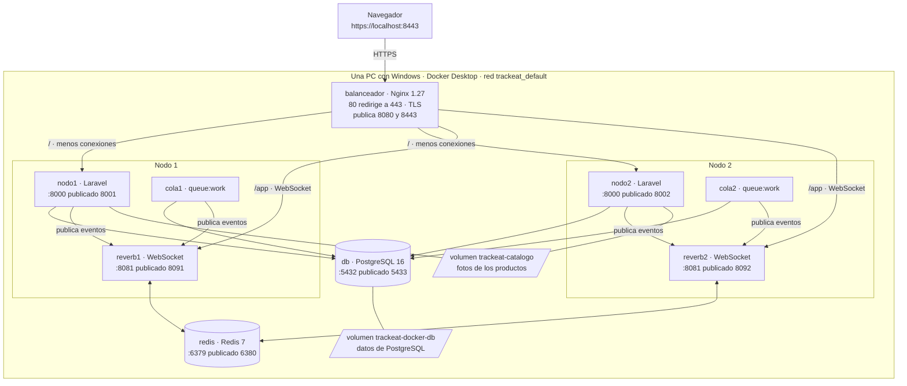
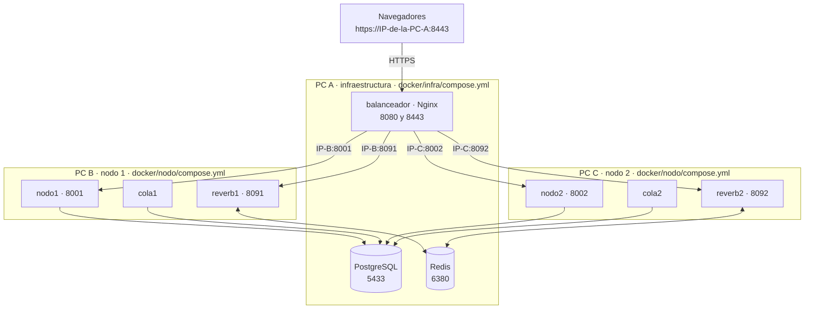

# TrackEat · Manual de despliegue

> Cómo instalar y poner en marcha TrackEat en una computadora con Windows usando Docker, desde un clon limpio del repositorio.
> Modo principal: **una sola PC** (9 contenedores). Los modos con dos y tres PCs están en el [Apéndice A](#apéndice-a--despliegue-en-varias-pcs).
> Documentación técnica · Persona 4 · Responsable: Andryk Manuel León Tapia · Redactado el 2026-11-25.

## Contenido

1. [Resumen](#1-resumen)
2. [Requisitos](#2-requisitos)
3. [Arquitectura](#3-arquitectura)
4. [Instalación paso a paso](#4-instalación-paso-a-paso)
5. [Verificación](#5-verificación)
6. [Operación](#6-operación)
7. [Solución de problemas](#7-solución-de-problemas)
8. [Apéndice A · Despliegue en varias PCs](#apéndice-a--despliegue-en-varias-pcs)
9. [Apéndice B · Configuración, puertos y cuentas](#apéndice-b--configuración-puertos-y-cuentas)
10. [Anexo · Registro de la prueba en otra computadora](#anexo--registro-de-la-prueba-en-otra-computadora)

---

## 1. Resumen

TrackEat se despliega con **Docker Compose** como **nueve contenedores** en una misma red:

| Contenedor | Qué es |
|---|---|
| `trackeat-balanceador` | Nginx: única puerta de entrada, con HTTPS y reparto de carga. |
| `trackeat-nodo1`, `trackeat-nodo2` | La aplicación (Laravel + el frontend ya compilado), dos copias iguales. |
| `trackeat-reverb1`, `trackeat-reverb2` | Servidores WebSocket (tiempo real de comandas y pedidos), uno por nodo. |
| `trackeat-cola1`, `trackeat-cola2` | Procesan la cola de tareas de cada nodo. |
| `trackeat-db-docker` | PostgreSQL 16: la base de datos única. |
| `trackeat-redis` | Redis 7: canal compartido entre los dos servidores WebSocket. |

**Qué obtienes al terminar:** el sitio en `https://localhost:8443`, con datos de demostración (6 cuentas, 4 productos con foto y 4 pedidos de ejemplo) y los dos nodos repartiéndose la carga.

**Tiempo estimado:** entre 30 y 45 minutos la primera vez, casi todo en descargas (Docker Desktop, imágenes y paquetes). Las veces siguientes, de 1 a 2 minutos.

**Qué verificó el autor y qué falta por probar.** Los pasos de las secciones 4 a 6 se ejecutaron en un clon limpio del repositorio en Windows, con PowerShell. Las marcas indican el estado de cada paso:

- **Verificado:** se ejecutó en un clon limpio y dio el resultado indicado.
- **Por probar en otra PC:** depende de instalar programas o de confiar en un certificado en la computadora destino, o requiere los puertos libres. No se pudo ejecutar en la misma PC donde ya corre el sistema (los nombres de contenedor y los puertos están fijos y chocan). El [Anexo](#anexo--registro-de-la-prueba-en-otra-computadora) sirve para registrar esa prueba.

---

## 2. Requisitos

### Equipo

| Requisito | Detalle |
|---|---|
| Sistema | Windows 10 u 11 de 64 bits. |
| Memoria | 8 GB de RAM como mínimo (Docker Desktop con WSL 2 usa varios GB). |
| Disco | Unos 10 GB libres (imágenes de Docker, paquetes y base de datos). |
| Red | Internet durante la instalación (imágenes, paquetes y, al iniciar sesión, el captcha de Cloudflare). |

### Programas

| Programa | Versión | Para qué | Cómo instalarlo |
|---|---|---|---|
| **Docker Desktop** | Reciente, con WSL 2 | Ejecuta los contenedores. | <https://www.docker.com/products/docker-desktop/> |
| **Git** | Cualquiera | Clonar el repositorio. Incluye `openssl`, que se usa como alternativa para el certificado. | `winget install Git.Git` |
| **Node.js** | 18, 20 o 22 o superior | Compila el frontend. | `winget install OpenJS.NodeJS.LTS` |
| **pnpm** | 9 o superior | Gestor de paquetes del frontend. | `npm install -g pnpm` |
| **mkcert** | 1.4 o superior | Certificado HTTPS de confianza para `localhost`. | `winget install FiloSottile.mkcert` |

No hace falta instalar PHP ni Composer: las dependencias de PHP se instalan dentro de Docker (paso 3). Después de instalar los programas, **cierra y abre PowerShell** para que reconozca los comandos nuevos.

Comprueba que todo responde:

```powershell
docker --version
docker compose version
git --version
node --version
pnpm --version
```

### Puertos libres

El sistema publica estos puertos en `127.0.0.1`. Ninguno debe estar en uso.

| Puerto | Servicio |
|---|---|
| 8080 | Balanceador, HTTP (redirige a HTTPS). |
| 8443 | Balanceador, HTTPS. **Es la dirección que usan las personas.** |
| 8001, 8002 | Nodos 1 y 2 directos, para pruebas. |
| 8091, 8092 | Servidores WebSocket de cada nodo. |
| 5433 | PostgreSQL. |
| 6380 | Redis. |

Para ver cuáles están ocupados (no debe aparecer ninguna fila):

```powershell
Get-NetTCPConnection -State Listen -LocalPort 8080,8443,8001,8002,8091,8092,5433,6380 -ErrorAction SilentlyContinue |
    Select-Object LocalPort, OwningProcess
```

---

## 3. Arquitectura



Lo esencial:

- **Todo entra por el balanceador** (`:8443`). Reparte las peticiones al nodo con menos conexiones y las conexiones WebSocket (`/app`) al servidor Reverb con menos conexiones. Si un nodo cae, el otro atiende.
- **La sesión, la caché y la cola viven en PostgreSQL**, no en memoria: cualquier nodo puede atender a cualquier persona sin perder la sesión.
- **Redis une a los dos servidores WebSocket**: un evento publicado en uno llega a los navegadores conectados al otro.
- **Dos volúmenes con nombre** conservan los datos aunque se recreen los contenedores: la base de datos (`trackeat-docker-db`) y las fotos (`trackeat-catalogo`, compartido por los dos nodos).

---

## 4. Instalación paso a paso

Todos los comandos son para **PowerShell** y se ejecutan desde la **raíz del proyecto** (la carpeta `trackeat-web`), salvo que se indique otra cosa.

### Paso 1 · Clonar el repositorio

```powershell
git clone https://github.com/AndrykLeonT/trackeat-web.git
cd trackeat-web
```

La rama `main` es la definitiva. **Verificado.**

Un clon limpio **no trae** estos archivos, que se crean en los pasos 3 al 6: `backend/vendor`, `frontend/node_modules`, `backend/public/build`, `backend/.env`, `docker/.env` y `docker/infra/tls`. Están excluidos de Git a propósito (contienen secretos o se generan).

### Paso 2 · Encender Docker Desktop

Abre Docker Desktop y espera a que indique que el motor está en ejecución. Comprueba:

```powershell
docker info --format "{{.ServerVersion}}"
```

Debe mostrar un número de versión. Si dice que no puede conectar, Docker Desktop aún no terminó de arrancar.

### Paso 3 · Compilar el frontend

El frontend (Svelte) se compila en Windows y el resultado se copia dentro de la imagen de Docker. Para compilarlo hacen falta antes las dependencias de PHP, porque el compilador importa un paquete de Composer (`tightenco/ziggy`). Sin PHP instalado, se instalan con Docker.

```powershell
# 3.1 Dependencias de PHP (una vez; unos 4 minutos la primera vez por las descargas)
docker run --rm -v "${PWD}\backend:/app" -w /app composer:2 install --no-interaction --prefer-dist --no-scripts --ignore-platform-reqs

# 3.2 Dependencias del frontend
pnpm --dir frontend install --frozen-lockfile

# 3.3 Compilar
pnpm --dir frontend build
```

**Resultado esperado:** el último comando termina con tres líneas `built in …` y existen `backend/public/build/manifest.json`, `backend/public/menu/index.html` y `backend/public/personal/index.html`. Puede mostrar advertencias de Svelte (`state_referenced_locally`): no detienen la compilación. **Verificado** (el paso 3.1 tardó 4 minutos 20 segundos, el 3.2 unos 5 segundos y el 3.3 unos 11).

> **Atención:** si se omite 3.1, el paso 3.3 falla con `Could not load …\backend\vendor\tightenco\ziggy\dist\index.js`. Ver la [sección 7](#7-solución-de-problemas).

### Paso 4 · Crear `backend/.env` y la clave de la aplicación

```powershell
Copy-Item backend/.env.example backend/.env

# Genera una APP_KEY aleatoria de 32 bytes (no necesita PHP) y la escribe en backend/.env
$bytes = New-Object byte[] 32
$rng = [Security.Cryptography.RandomNumberGenerator]::Create()
$rng.GetBytes($bytes)
$rng.Dispose()
$clave = 'base64:' + [Convert]::ToBase64String($bytes)
(Get-Content backend/.env) -replace '^APP_KEY=.*', "APP_KEY=$clave" | Set-Content -Encoding ascii backend/.env
```

**Resultado esperado:** `Select-String '^APP_KEY=' backend/.env` muestra `APP_KEY=base64:` seguido de unos 44 caracteres. **Verificado:** Laravel acepta esa clave (cifra y descifra), y la aplicación arrancó con ese `.env` y esa clave.

Notas:

- `APP_ENV=local` (el valor de `.env.example`) es necesario para cargar los datos de demostración: los *seeders* se niegan a correr en otros entornos.
- Los valores de base de datos, Redis y WebSocket de `backend/.env` los **sustituye Docker Compose**, así que no hace falta editarlos.
- El envío de correos (recuperar contraseña) necesita un servidor SMTP configurado en este archivo. Sin él, el resto del sistema funciona. Ver [`docs/evidencias/01-usuarios-panel-seguridad.md`](../evidencias/01-usuarios-panel-seguridad.md#correo-real-con-gmail).
- **Nunca subas `backend/.env` a Git**; ya está excluido.

### Paso 5 · Crear `docker/.env` con las credenciales

Contiene las tres contraseñas privadas del despliegue (base de datos, Redis y servidor WebSocket). Se generan aleatorias:

```powershell
if (Test-Path docker/.env) { throw 'Ya existe docker/.env. Conserva su configuración.' }
$rng = [Security.Cryptography.RandomNumberGenerator]::Create()
try {
    $valores = foreach ($nombre in 'DB_PASSWORD', 'REDIS_PASSWORD', 'REVERB_APP_SECRET') {
        $bytes = New-Object byte[] 24
        $rng.GetBytes($bytes)
        "$nombre=$([BitConverter]::ToString($bytes).Replace('-', '').ToLowerInvariant())"
    }
    $valores | Set-Content -Encoding ascii docker/.env
} finally {
    $rng.Dispose()
}
```

**Resultado esperado:** `docker/.env` existe con tres líneas (`DB_PASSWORD=…`, `REDIS_PASSWORD=…`, `REVERB_APP_SECRET=…`). **Verificado.**

> **Importante:** el valor de `DB_PASSWORD` solo se aplica la **primera vez** que PostgreSQL crea su volumen. Si ya existía un volumen con otra contraseña, hay que cambiarla dentro de la base (ver el [Apéndice B](#apéndice-b--configuración-puertos-y-cuentas)). Guarda este archivo: si lo pierdes, no podrás conectarte a esa base. **Nunca lo subas a Git**; ya está excluido.

Comprueba que Docker Compose entiende la configuración:

```powershell
docker compose -f docker/compose.yml config --quiet
```

No debe imprimir nada (sin errores). Si falta algún archivo `.env`, el error lo dice con claridad. **Verificado.**

### Paso 6 · Certificado HTTPS

El balanceador sirve HTTPS y **no arranca sin certificado**. Hay dos caminos.

**Camino recomendado: mkcert** (certificado en el que el navegador confía, sin advertencias).

```powershell
winget install FiloSottile.mkcert
# Cierra y abre PowerShell, vuelve a la raíz del proyecto y ejecuta:
New-Item -ItemType Directory -Force docker/infra/tls | Out-Null
mkcert -install
mkcert -cert-file docker/infra/tls/server.pem -key-file docker/infra/tls/server-key.pem localhost 127.0.0.1 ::1
```

`mkcert -install` agrega una autoridad certificadora local al almacén de confianza de Windows y muestra una ventana de confirmación. Después **reinicia Edge o Chrome** si ya estaban abiertos. El identificador de winget se confirmó; la instalación y la confianza del navegador son **por probar en otra PC**. La clave `rootCA-key.pem` (en `mkcert -CAROOT`) debe quedarse en esa computadora. Más detalles en [`docs/evidencias/02-nginx-https.md`](../evidencias/02-nginx-https.md).

**Camino alternativo: certificado autofirmado con `openssl`** (si no puedes instalar mkcert). Funciona igual, pero el navegador mostrará una advertencia de seguridad que hay que aceptar manualmente la primera vez.

```powershell
New-Item -ItemType Directory -Force docker/infra/tls | Out-Null
& 'C:\Program Files\Git\usr\bin\openssl.exe' req -x509 -newkey rsa:2048 -nodes -days 365 `
    -keyout docker/infra/tls/server-key.pem -out docker/infra/tls/server.pem `
    -subj "/CN=localhost" -addext "subjectAltName=DNS:localhost,IP:127.0.0.1,IP:::1"
```

**Resultado esperado (cualquiera de los dos caminos):** existen `docker/infra/tls/server.pem` y `docker/infra/tls/server-key.pem`. **Verificado** el camino de `openssl`. Los archivos `.pem` están excluidos de Git.

### Paso 7 · Construir y levantar

```powershell
docker compose -f docker/compose.yml up -d --build
```

La primera vez construye la imagen (unos 4 minutos) y descarga las imágenes de PostgreSQL, Redis y Nginx. Después:

```powershell
docker compose -f docker/compose.yml ps
```

**Resultado esperado:** los 9 contenedores en `Up`; la base de datos y Redis en `(healthy)`. Es normal que `cola1`, `cola2` o los `reverb` se reinicien una o dos veces al principio, mientras la base aún no tiene tablas.

Estado: la construcción de la imagen **se verificó** desde un clon limpio (los cinco archivos de los pasos 3 al 6 son lo único que necesita). El `up -d` completo desde cero es **por probar en otra PC**, por los puertos.

### Paso 8 · Crear las tablas y cargar los datos de demostración

Solo la primera vez:

```powershell
docker compose -f docker/compose.yml exec nodo1 php artisan migrate --seed --force
```

**Resultado esperado:** una lista de migraciones en `DONE` y, al final, `DemoSeeder` y `CatalogoImagenesSeeder` en `DONE`. **Verificado** en una base nueva: deja 6 usuarios, 4 productos, 4 pedidos y 4 fotos de producto.

Notas:

- Las fotos se guardan en el volumen `trackeat-catalogo`, que comparten los dos nodos, así que basta con ejecutarlo una vez.
- Repetirlo no daña los datos de demostración: el *seeder* los reconoce.
- Para un sistema real (no demostración) se omite `--seed`, y las cuentas se crean desde el panel de administración.

### Paso 9 · Verificar

Sigue la [sección 5](#5-verificación).

---

## 5. Verificación

### 5.1 El sistema responde y reparte la carga

```powershell
1..6 | ForEach-Object { (Invoke-WebRequest https://localhost:8443/salud -UseBasicParsing).Content }
```

Si usaste un certificado autofirmado, PowerShell 5.1 rechazará el certificado; usa mejor `curl.exe -sk https://localhost:8443/salud` (seis veces) o abre la dirección en el navegador.

**Resultado esperado:** seis respuestas JSON que alternan `"nodo":"1"` y `"nodo":"2"`, con `"bd":"ok"`.

### 5.2 HTTP redirige a HTTPS

```powershell
curl.exe -sSI http://localhost:8080/login
```

**Resultado esperado:** `301` con `Location: https://localhost:8443/login`.

### 5.3 En el navegador

Abre `https://localhost:8443` y comprueba:

1. La página de inicio carga y `Menú Digital` muestra los 4 productos **con su foto** (si ves el logo, pulsa "Actualizar menú").
2. Inicia sesión con una cuenta de demostración (ver abajo). El inicio de sesión muestra el captcha de Cloudflare: basta con hacer clic en "Verifica que eres humano". Necesita internet.
3. Cada rol llega a su pantalla de inicio y solo ve las opciones que le corresponden.

**Cuentas de demostración.** Contraseña de todas: `TrackEatDemo!2026`.

| Rol | Correo |
|---|---|
| Administrador | `administrador@example.test` |
| Cajero | `cajero@example.test` |
| Mesero | `mesero@example.test` |
| Cocinero | `cocinero@example.test` |
| Cliente | `cliente1@example.test`, `cliente2@example.test` |

Los flujos de pedidos, comandas y pagos, paso a paso, están en [`Backlog_Andryk/guia-de-pruebas-modulo-2.md`](../../Backlog_Andryk/guia-de-pruebas-modulo-2.md).

### 5.4 Cada nodo por separado (opcional)

`http://127.0.0.1:8001/salud` y `http://127.0.0.1:8002/salud` deben responder `"nodo":"1"` y `"nodo":"2"`.

### 5.5 Tolerancia a fallos (opcional)

```powershell
docker stop trackeat-nodo2      # el sitio sigue; responde solo el nodo 1
docker start trackeat-nodo2
```

---

## 6. Operación

Todos los comandos desde la raíz del proyecto.

### Detener y volver a encender

```powershell
docker compose -f docker/compose.yml stop       # detiene, conserva todo
docker compose -f docker/compose.yml start      # vuelve a encender
docker compose -f docker/compose.yml down       # elimina los contenedores; los datos y las fotos se conservan
```

### Ver el estado y los registros

```powershell
docker compose -f docker/compose.yml ps
docker compose -f docker/compose.yml logs --tail 50 nodo1
docker compose -f docker/compose.yml logs --tail 50 balanceador
```

### Actualizar a una versión nueva

```powershell
git pull

# Solo si cambió backend/composer.lock:
docker run --rm -v "${PWD}\backend:/app" -w /app composer:2 install --no-interaction --prefer-dist --no-scripts --ignore-platform-reqs

# Solo si cambió frontend/pnpm-lock.yaml:
pnpm --dir frontend install --frozen-lockfile

pnpm --dir frontend build
docker compose -f docker/compose.yml up -d --build
docker compose -f docker/compose.yml exec nodo1 php artisan migrate --force
```

Si algo cambió y no lo notas, no pasa nada por ejecutar todos los pasos. Una imagen vieja es la causa más común de que "falte" una pantalla o ruta nueva: **siempre** hay que reconstruir con `--build`. Si el balanceador responde 502 unos segundos después de actualizar, espera un momento o ejecuta `docker compose -f docker/compose.yml restart balanceador`.

### Respaldar la base de datos

En PowerShell 5.1 no uses `>` para guardar el respaldo: escribe en UTF-16 y el archivo no se puede restaurar. Usa este método:

```powershell
docker exec trackeat-db-docker sh -c "pg_dump -U trackeat -d trackeat -f /tmp/respaldo.sql"
docker cp trackeat-db-docker:/tmp/respaldo.sql .\respaldo.sql
docker exec trackeat-db-docker sh -c "rm /tmp/respaldo.sql"
```

**Verificado.** Las fotos se respaldan aparte: están en el volumen `trackeat-catalogo`.

### Restaurar un respaldo en una base vacía

```powershell
docker exec trackeat-db-docker psql -U trackeat -d postgres -c "CREATE DATABASE trackeat_restaurada OWNER trackeat"
docker cp .\respaldo.sql trackeat-db-docker:/tmp/restaurar.sql
docker exec trackeat-db-docker sh -c "psql -U trackeat -d trackeat_restaurada -v ON_ERROR_STOP=1 -q -o /dev/null -f /tmp/restaurar.sql"
docker exec trackeat-db-docker psql -U trackeat -d trackeat_restaurada -c "select count(*) from users"
```

**Verificado.** Para sustituir la base activa, primero detén los nodos y luego restaura sobre una base vacía con el nombre `trackeat`.

### Empezar desde cero

> **Esto borra la base de datos y las fotos.** Haz un respaldo antes.

```powershell
docker compose -f docker/compose.yml down -v
docker compose -f docker/compose.yml up -d --build
docker compose -f docker/compose.yml exec nodo1 php artisan migrate --seed --force
```

---

## 7. Solución de problemas

Los tres primeros errores se reprodujeron en un clon limpio y su texto es el real.

| Síntoma | Causa | Solución |
|---|---|---|
| `required variable DB_PASSWORD is missing a value: Define DB_PASSWORD en docker/.env` | Falta `docker/.env`. | Paso 5. |
| `env file …\backend\.env not found` | Falta `backend/.env`. | Paso 4. |
| El frontend falla con `Could not load …\backend\vendor\tightenco\ziggy\dist\index.js` | Faltan las dependencias de PHP. | Paso 3.1, antes de `pnpm build`. |
| `trackeat-balanceador` se reinicia sin parar y sus registros dicen `cannot load certificate "/etc/nginx/trackeat-tls/server.pem"` | Falta el certificado. | Paso 6. |
| `Error 500` en todas las páginas, o "No application encryption key has been specified" | `APP_KEY` vacía en `backend/.env`. | Paso 4. |
| Faltan pantallas o rutas que sí existen en el código (por ejemplo `/admin/pedidos`) | La imagen de Docker es vieja. | Actualizar con `up -d --build` y `migrate --force` (sección 6). |
| Los productos muestran el logo y no su foto | Aún no se sembraron las fotos, o el navegador guardó el menú anterior. | `docker compose -f docker/compose.yml exec nodo1 php artisan db:seed --class=CatalogoImagenesSeeder --force` y, en el menú, "Actualizar menú". |
| `port is already allocated` o `bind … address already in use` | Otro programa usa uno de los puertos. | Ver los puertos ocupados (sección 2) y cerrar ese programa. Si `presentar.bat` está abierto, ciérralo. |
| `error during connect` o `cannot connect to the Docker daemon` | Docker Desktop no está encendido. | Abrir Docker Desktop y esperar a que termine de arrancar. |
| El navegador muestra "La conexión no es privada" | Certificado autofirmado, o mkcert no instalado en esta PC. | Aceptar la advertencia, o repetir el paso 6 con mkcert y reiniciar el navegador. |
| El inicio de sesión no avanza | El captcha de Cloudflare no se pudo cargar (sin internet) o no se completó. | Comprobar la conexión y completar el captcha. |
| La página carga pero el tiempo real no conecta (punto de conexión rojo) | Los servidores WebSocket no están en `Up`, o `URL_PUBLICA` no coincide con la dirección que usas. | `docker compose -f docker/compose.yml ps` y revisar `reverb1` y `reverb2`. |
| `/salud` responde 503 con `"bd":"caida"` | PostgreSQL no está sano. | `docker compose -f docker/compose.yml logs db`; espera a que esté `(healthy)`. |
| Un cliente no puede hacer otro pedido | Llegó al límite de 3 pedidos en curso. | Entregar o cancelar alguno. |

---

# Apéndice A · Despliegue en varias PCs

Los mismos archivos de Docker se pueden repartir en dos o tres computadoras de la misma red. La elección de arquitectura determina **qué archivo de Compose se ejecuta en cada PC**:

| Arquitectura | PC | Qué corre | Archivo de Compose que se ejecuta |
|---|---|---|---|
| **Una PC** (modo principal de este manual) | Única | Todo | `docker/compose.yml` (incluye los dos siguientes) |
| **Dos PCs** | A | Infraestructura y nodo 1 | `docker/infra/compose.yml` y `docker/nodo/compose.yml` (solo `nodo1 reverb1 cola1`) |
| | B | Nodo 2 | `docker/nodo/compose.yml` (solo `nodo2 reverb2 cola2`) |
| **Tres PCs** | A | PostgreSQL, Redis y balanceador | `docker/infra/compose.yml` |
| | B | Nodo 1 | `docker/nodo/compose.yml` (solo `nodo1 reverb1 cola1`) |
| | C | Nodo 2 | `docker/nodo/compose.yml` (solo `nodo2 reverb2 cola2`) |

> **Estado de estos modos:** están preparados y su configuración se validó, pero **no se han probado entre computadoras distintas**. Si algo no conecta, casi siempre es el firewall de Windows o una IP mal escrita. La guía completa, con todas las variables y el diagnóstico, es [`cambiar a 3 pc.md`](../../cambiar%20a%203%20pc.md); este apéndice resume lo necesario.



### A.1 Qué cambia respecto a una PC

| | Una PC | Varias PCs |
|---|---|---|
| Cómo se encuentran los contenedores | Por nombre, dentro de la red de Docker | Por **IP de la PC** y puerto publicado |
| `docker/.env` | Solo credenciales | Credenciales **más las IPs reales**, y el **mismo archivo en todas las PCs** |
| Comando | `docker compose -f …` | `docker compose --env-file docker/.env -f …` |
| `backend/.env` | Uno | **El mismo archivo en las PCs de nodo**: la `APP_KEY` debe ser idéntica, o un nodo no puede leer la sesión del otro. |
| Firewall de Windows | No aplica | Abrir puertos en cada PC |
| Fotos del catálogo | Un volumen compartido por los dos nodos | **Cada PC tiene su volumen**: ver A.6 |

El `--env-file` es obligatorio porque los archivos de Compose están en `docker/infra/` y `docker/nodo/`, y Docker solo lee automáticamente el `.env` de la carpeta del archivo que se ejecuta.

### A.2 Preparar cada PC

1. Instalar y encender Docker Desktop, y **clonar el repositorio** (paso 1 de la sección 4).
2. En las PCs de **nodo** (B y C): seguir los pasos 3 y 4 de la sección 4 (frontend compilado y `backend/.env`). La PC de **infraestructura** (A) no necesita ni el frontend ni `backend/.env`, solo `docker/.env` y el certificado.
3. **`backend/.env` idéntico** en las PCs de nodo: genera el archivo en una y cópialo a la otra por USB o red compartida.
4. En la PC A, el certificado del paso 6, con la **IP o el nombre de la PC A** en lugar de `localhost`:
   ```powershell
   mkcert -cert-file docker/infra/tls/server.pem -key-file docker/infra/tls/server-key.pem 192.168.1.10 localhost 127.0.0.1 ::1
   ```
   Cada navegador que abra el sitio debe confiar en esa autoridad (`mkcert -install` en cada computadora que lo use, o aceptar la advertencia).

### A.3 `docker/.env` (el mismo en todas las PCs)

Parte del `docker/.env` del paso 5 (con las tres credenciales, **iguales en todas las PCs**) y agrega las IPs. Ejemplo con tres PCs (cambia las IPs por las tuyas; se ven con `ipconfig`):

```
ESCUCHA=0.0.0.0

# Dónde está la infraestructura (PC A)
DB_HOST=192.168.1.10
DB_PORT=5433
REDIS_HOST=192.168.1.10
REDIS_PORT=6380

# Dónde están los nodos, tal como los ve el balanceador (IP de cada PC : puerto publicado)
NODO1_ADDR=192.168.1.11:8001
NODO2_ADDR=192.168.1.12:8002
REVERB1_ADDR=192.168.1.11:8091
REVERB2_ADDR=192.168.1.12:8092

# Dirección con la que el navegador entra (la del balanceador, PC A)
URL_PUBLICA=https://192.168.1.10:8443

# Dirección de la PC del balanceador: los nodos solo creen en X-Forwarded-* de ese proxy
TRUSTED_PROXIES=192.168.1.10
```

Para **dos PCs**, la PC A corre también el nodo 1: pon `NODO1_ADDR=192.168.1.10:8001` y `REVERB1_ADDR=192.168.1.10:8091`.

### A.4 Firewall de Windows

En cada PC, PowerShell **como administrador**:

```powershell
# PC A (infraestructura)
New-NetFirewallRule -DisplayName "TrackEat infra" -Direction Inbound -Protocol TCP -LocalPort 8080,8443,5433,6380 -Action Allow -Profile Any
# PC B (nodo 1)
New-NetFirewallRule -DisplayName "TrackEat nodo1" -Direction Inbound -Protocol TCP -LocalPort 8001,8091 -Action Allow -Profile Any
# PC C (nodo 2)
New-NetFirewallRule -DisplayName "TrackEat nodo2" -Direction Inbound -Protocol TCP -LocalPort 8002,8092 -Action Allow -Profile Any
```

En el modo de dos PCs, la PC A abre además 8001 y 8091. Para quitar las reglas: `Remove-NetFirewallRule -DisplayName "TrackEat infra"` (y lo mismo con los otros nombres).

### A.5 Levantar

Desde la raíz del proyecto de cada PC. El orden no es estricto, pero así es más limpio. Los nombres de servicio al final de los comandos de nodo **son obligatorios**: sin ellos, Docker intenta levantar los seis.

```powershell
# PC A (infraestructura)
docker compose --env-file docker/.env -f docker/infra/compose.yml up -d

# PC B (nodo 1)
docker compose --env-file docker/.env -f docker/nodo/compose.yml up -d --build nodo1 reverb1 cola1

# PC C (nodo 2)
docker compose --env-file docker/.env -f docker/nodo/compose.yml up -d --build nodo2 reverb2 cola2
```

En el modo de **dos PCs**, la PC A ejecuta los dos primeros comandos (infraestructura y nodo 1) y la PC B ejecuta el tercero.

Una sola vez, desde la PC del nodo 1, crear las tablas y los datos de demostración:

```powershell
docker compose --env-file docker/.env -f docker/nodo/compose.yml exec nodo1 php artisan migrate --seed --force
```

### A.6 Fotos del catálogo en varias PCs

Cada PC de nodo tiene su propio volumen `trackeat-catalogo`. Las filas de la base (rutas de las fotos) se crean una vez, pero **el archivo de cada foto debe existir en cada PC**. Como las fotos de ejemplo se generan con el mismo nombre, basta con ejecutar en **cada PC de nodo**:

```powershell
docker compose --env-file docker/.env -f docker/nodo/compose.yml exec nodo1 php artisan db:seed --class=CatalogoImagenesSeeder --force
```

(en la PC del nodo 2, usa `exec nodo2`). Una foto que se suba a mano desde el panel de administración solo queda en la PC que recibió esa petición.

### A.7 Comprobar

Desde cualquier PC de la red, `https://IP-de-la-PC-A:8443/salud` varias veces: `nodo` alterna entre `"1"` y `"2"`. Si algo falla, desde PowerShell:

```powershell
Test-NetConnection 192.168.1.10 -Port 5433   # ¿llega a PostgreSQL? (desde B y C)
Test-NetConnection 192.168.1.10 -Port 6380   # ¿llega a Redis?      (desde B y C)
Test-NetConnection 192.168.1.11 -Port 8001   # ¿llega al nodo 1?    (desde A)
Test-NetConnection 192.168.1.12 -Port 8002   # ¿llega al nodo 2?    (desde A)
```

Cada una debe decir `TcpTestSucceeded : True`. El diagnóstico por síntomas (502, sesión que se pierde, tiempo real que no conecta, IP que cambió) está en [`cambiar a 3 pc.md`](../../cambiar%20a%203%20pc.md#si-algo-falla).

### A.8 Apagar

```powershell
docker compose --env-file docker/.env -f docker/infra/compose.yml down   # PC A
docker compose --env-file docker/.env -f docker/nodo/compose.yml down    # PC B y C
```

---

# Apéndice B · Configuración, puertos y cuentas

### Variables de `docker/.env`

| Variable | Obligatoria | Qué es |
|---|---|---|
| `DB_PASSWORD` | Sí | Contraseña de PostgreSQL. |
| `REDIS_PASSWORD` | Sí | Contraseña de Redis. |
| `REVERB_APP_SECRET` | Sí | Secreto de los servidores WebSocket. |
| `ESCUCHA` | No | `127.0.0.1` por omisión (solo esta PC). `0.0.0.0` para aceptar otras PCs. |
| `URL_PUBLICA` | No | Dirección HTTPS con la que se entra. Por omisión `https://localhost:8443`. |
| `DB_HOST`, `DB_PORT`, `REDIS_HOST`, `REDIS_PORT` | Solo varias PCs | Dónde están PostgreSQL y Redis. |
| `NODO1_ADDR`, `NODO2_ADDR`, `REVERB1_ADDR`, `REVERB2_ADDR` | Solo varias PCs | Dónde están los nodos para el balanceador. |
| `TRUSTED_PROXIES` | Solo varias PCs | IP del balanceador. |
| `HTTP_PUERTO_PUBLICADO`, `HTTPS_PUERTO_PUBLICADO` | No | Puertos del balanceador (8080 y 8443 por omisión). |
| `TLS_DIR` | No | Carpeta con `server.pem` y `server-key.pem` (`./tls` por omisión). |
| `TURNSTILE_SITE_KEY`, `TURNSTILE_SECRET_KEY` | No | Llaves del captcha. Por omisión, las llaves de **prueba** públicas de Cloudflare; para uso real, poner las propias. |

La lista completa y comentada está en [`docker/.env.example`](../../docker/.env.example).

### Cambiar la contraseña de una base que ya existe

`DB_PASSWORD` solo se aplica cuando PostgreSQL crea su volumen. Si ya hay datos con otra contraseña, con el contenedor de la base encendido:

```powershell
docker exec -it trackeat-db-docker psql -U trackeat -d trackeat -c '\password trackeat'
```

e introduce por el aviso el mismo valor que guardaste en `DB_PASSWORD`.

### Datos que se conservan

| Dato | Dónde | Se conserva con `down` | Se borra con `down -v` |
|---|---|---|---|
| Base de datos | Volumen `trackeat-docker-db` | Sí | **Sí** |
| Fotos del catálogo | Volumen `trackeat-catalogo` | Sí | **Sí** |
| Sesiones, caché y cola | Tablas de PostgreSQL | Sí | **Sí** |
| Redis (canal de eventos) | Memoria | No (no guarda nada) | — |

### Qué no va en Git

`backend/.env`, `docker/.env`, `docker/infra/tls/*.pem`, `backend/vendor`, `frontend/node_modules`, `backend/public/build` y la carpeta de fotos. Si un archivo con secretos se sube por error, cambia esas credenciales de inmediato.

### Otras formas de ejecutar el proyecto

Para desarrollar sin Docker (PostgreSQL local con los `.bat`), ver [`docs/equipo.md`](../equipo.md).

---

# Anexo · Registro de la prueba en otra computadora

Completar al instalar el sistema en una computadora distinta de la del autor. Sirve como evidencia de que el manual funciona desde cero.

**Datos de la prueba**

| Campo | Valor |
|---|---|
| Fecha | |
| Quién la hizo | |
| Equipo (marca, RAM) | |
| Sistema operativo y versión | |
| Docker Desktop (versión) | |
| ¿Docker Desktop y los programas ya estaban instalados? | |
| Rama y commit (`git log --oneline -1`) | |

**Resultado por paso**

| Paso | ¿Funcionó? | Tiempo | Observaciones o error exacto |
|---|---|---|---|
| 1 · Clonar | | | |
| 2 · Docker Desktop encendido | | | |
| 3.1 · Dependencias de PHP con Docker | | | |
| 3.2 y 3.3 · Frontend compilado | | | |
| 4 · `backend/.env` y `APP_KEY` | | | |
| 5 · `docker/.env` | | | |
| 6 · Certificado (¿mkcert u openssl?) | | | |
| 7 · `up -d --build` y 9 contenedores en `Up` | | | |
| 8 · `migrate --seed` | | | |
| 5.1 · `/salud` alterna los nodos | | | |
| 5.2 · HTTP redirige a HTTPS | | | |
| 5.3 · Login con una cuenta de cada rol | | | |
| 5.3 · Fotos visibles en el menú | | | |
| **Tiempo total, de principio a fin** | | | |

**Comandos o pasos del manual que hubo que corregir o aclarar:**

&nbsp;

**Conclusión (¿el manual alcanzó para dejarlo funcionando sin ayuda?):**

&nbsp;
